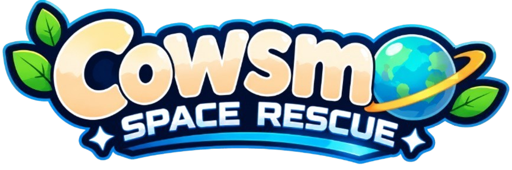

<div align="center">

# Cowsmo: Space Rescue

### Ecosistema digital de entretenimiento y educación ambiental

**«Reciclar, recuperar y reconstruir»**


<br>


<br><br>


&nbsp;&nbsp;&nbsp;&nbsp;


**Orbital Create** · Proyecto integrador Cowsmo: Space Rescue

</div>

---

## Índice

1. [Acerca del proyecto](#-1-acerca-del-proyecto)
2. [Problemática y justificación](#-2-problemática-y-justificación)
3. [Objetivos](#-3-objetivos)
4. [Ecosistema de productos](#-4-ecosistema-de-productos)
5. [Características principales](#-5-características-principales)
6. [Identidad y dirección visual](#-6-identidad-y-dirección-visual)
7. [Arquitectura del sistema](#-7-arquitectura-del-sistema)
8. [Tecnologías](#-8-tecnologías)
9. [Estructura del repositorio](#-9-estructura-del-repositorio)
10. [Requisitos previos](#-10-requisitos-previos)
11. [Instalación y configuración](#-11-instalación-y-configuración)
12. [Ejecución en desarrollo](#-12-ejecución-en-desarrollo)
13. [Funcionamiento general](#-13-funcionamiento-general)
14. [Datos, progreso y rankings](#-14-datos-progreso-y-rankings)
15. [Pruebas y calidad](#-15-pruebas-y-calidad)
16. [Metodología y equipo](#-16-metodología-y-equipo)
17. [Documentación y recursos](#-17-documentación-y-recursos)
18. [Estado y trabajo pendiente](#-18-estado-y-trabajo-pendiente)
19. [Versionamiento](#-19-versionamiento)
20. [Licencia](#-20-licencia)
21. [Contacto](#-21-contacto)

---

## 🌌 1. Acerca del proyecto

**Cowsmo: Space Rescue** es un ecosistema digital que integra tres productos: un videojuego de aventura 2.5D, una aplicación móvil y una aplicación web progresiva (PWA). Su propósito es combinar el entretenimiento interactivo con la educación ambiental y promover la reflexión sobre el reciclaje, la economía circular, la contaminación y la conservación de los ecosistemas.

La experiencia narrativa sigue a **Moo-ry**, una vaca espacial que emprende una misión para recuperar su planeta y rescatar a sus amigos. A lo largo de la aventura, el jugador explora escenarios afectados por la contaminación, recupera recursos y participa en acciones orientadas a restaurar el entorno.

Los tres productos forman parte de un mismo ecosistema y compartirán cuentas e información mediante un backend centralizado.

### Información general

| Elemento | Descripción |
|---|---|
| Nombre | Cowsmo: Space Rescue |
| Organización del proyecto | Orbital Create |
| Tipo | Ecosistema digital multiplataforma |
| Productos | Videojuego 2.5D, aplicación móvil y PWA |
| Propósito | Entretenimiento y educación ambiental |
| Público objetivo | Público general |
| Metodología | SCRUM |
| Estado | En desarrollo |

## 🌱 2. Problemática y justificación

La contaminación, la acumulación de residuos tecnológicos y la degradación de los ecosistemas son problemáticas que requieren mayor concientización y participación social. La educación ambiental puede fortalecerse mediante experiencias que permitan comprender estas situaciones de manera accesible e interactiva.

Cowsmo: Space Rescue plantea una alternativa basada en un universo narrativo y lúdico. El videojuego convierte la recuperación ambiental en parte de la experiencia de juego, mientras que la aplicación móvil y la PWA amplían el acceso a información, estadísticas y contenidos educativos.

La tecnología funciona como medio de comunicación y participación; el impacto educativo y la utilidad de las funcionalidades deberán evaluarse mediante pruebas con usuarios.

## 🎯 3. Objetivos

### Objetivo general

Desarrollar un ecosistema de software multiplataforma compuesto por un videojuego 2.5D, una aplicación móvil y una aplicación web progresiva, que integre experiencias de entretenimiento y herramientas educativas para fomentar la conciencia sobre la economía circular, el reciclaje y la conservación ambiental.

### Objetivos específicos

1. Desarrollar un videojuego de aventura 2.5D con mecánicas relacionadas con la recolección de residuos y la recuperación de entornos.
2. Implementar una aplicación móvil que complemente la experiencia del videojuego mediante perfiles, estadísticas y contenido educativo.
3. Construir una PWA que permita consultar información del ecosistema, rankings y recursos educativos.
4. Centralizar la autenticación y la gestión de información mediante una API compartida.
5. Diseñar mecanismos para guardar y sincronizar el progreso del jugador.
6. Incorporar un sistema de puntuaciones y clasificaciones que permita consultar resultados por nivel y por temporada.
7. Validar el funcionamiento, la integración y la usabilidad de los productos mediante pruebas.

## 🪐 4. Ecosistema de productos

El proyecto se compone de tres productos con responsabilidades complementarias:

| Producto | Tecnología principal | Propósito |
|---|---|---|
| Videojuego 2.5D | Unity 6 y C# | Ofrecer una experiencia de aventura, exploración y recuperación ambiental. |
| Aplicación móvil | Flutter y Dart | Complementar el juego con perfiles, estadísticas, progreso y contenido educativo. |
| Aplicación web progresiva | React y Vite | Facilitar el acceso web a perfiles, rankings, contenido educativo y Wiki-Cowsmo. |

### Videojuego — Unity

El videojuego es el núcleo de la experiencia interactiva. Está protagonizado por Moo-ry y presenta escenarios que reflejan las consecuencias de la contaminación y la posibilidad de restaurar los ecosistemas.

### Aplicación móvil — Flutter

La aplicación móvil proporciona acceso a las funcionalidades complementarias del ecosistema. Se conectará con el backend mediante la API y utilizará la cuenta compartida del usuario.

### Aplicación web progresiva — React

La PWA permitirá consultar información desde un navegador y ofrecerá disponibilidad parcial sin conexión para los recursos que se almacenen previamente en caché.

### Servicios compartidos

Los productos compartirán servicios para:

- Registro, inicio de sesión y administración de cuentas.
- Autenticación mediante JWT.
- Consulta y actualización de perfiles.
- Sincronización del progreso del jugador.
- Registro y consulta de puntuaciones.
- Clasificaciones generales y por temporada.
- Consulta y administración de contenido educativo.

## 🧩 5. Características principales

### Videojuego

- Exploración de escenarios y niveles.
- Interacción con personajes y elementos del entorno.
- Recolección de residuos y recursos.
- Actividades relacionadas con la recuperación ambiental.
- Sistema de progresión por niveles.
- Objetos y coleccionables.
- Registro de puntuaciones.
- Guardado local y sincronización en la nube.

### Aplicación móvil

- Registro e inicio de sesión.
- Administración del perfil.
- Consulta de estadísticas y progreso.
- Consulta de rankings.
- Consejos y actividades educativas ambientales.
- Información sobre reciclaje y sostenibilidad.
- Acceso a contenido complementario del videojuego.

### PWA

- Autenticación y consulta del perfil.
- Visualización de estadísticas y rankings.
- Acceso a contenido educativo.
- Publicación de contenido por parte de usuarios, sujeto a revisión administrativa.
- Acceso a Wiki-Cowsmo.
- Consulta de contenido previamente almacenado para uso parcial sin conexión.

> **Nota de alcance:** las características descritas representan el alcance funcional del ecosistema. Su presencia en este README no implica que todas se encuentren implementadas o desplegadas.

## 🎨 6. Identidad y dirección visual

La identidad de Cowsmo: Space Rescue utiliza una estética artesanal inspirada en maquetas, cartón corrugado, papel kraft y elementos construidos por capas. La dirección visual busca mantener una apariencia tipo *stop-motion*, con personajes de estilo chibi y escenarios espaciales.

La propuesta visual diferencia los entornos contaminados de los restaurados y mantiene una interfaz coherente con el universo del videojuego.

### Concepto visual y escenarios

<div align="center">

| Nébularis — entorno contaminado | Verdalia — entorno restaurado |
|:---:|:---:|
|  |  |

</div>

### Interfaz y protagonista

<div align="center">

| Interfaz y materiales teatrales | Moo-ry e identidad |
|:---:|:---:|
|  |  |

</div>

Los recursos anteriores funcionan como referencias visuales del proyecto. La guía de estilos establece los criterios para conservar la coherencia gráfica entre el videojuego, la aplicación móvil y la PWA.

## 🏗️ 7. Arquitectura del sistema

Cowsmo: Space Rescue contempla una arquitectura cliente-servidor centralizada. Unity, Flutter y React se comunicarán con un backend desarrollado en Python mediante FastAPI. El backend gestionará la autenticación, las reglas de negocio y el acceso a los sistemas de almacenamiento.

<div align="center">


<sub>Diagrama general de arquitectura del ecosistema.</sub>

</div>

### Componentes y responsabilidades

| Componente | Tecnología | Responsabilidad |
|---|---|---|
| Videojuego | Unity y C# | Gestionar niveles, mecánicas, puntuaciones y progreso de juego. |
| Aplicación móvil | Flutter y Dart | Presentar las funcionalidades complementarias en dispositivos móviles. |
| PWA | React y Vite | Proporcionar acceso web a los servicios y contenidos del ecosistema. |
| Backend | Python y FastAPI | Exponer la API, validar solicitudes y ejecutar la lógica de negocio. |
| Base de datos principal de la API | MongoDB | Gestionar los datos principales del ecosistema. |
| Base de datos complementaria | MySQL | Gestionar información estructurada asociada al videojuego. |
| Contenedores | Docker | Empaquetar servicios y dependencias. |
| Ejecución en la nube | Google Cloud Run | Ejecutar los servicios contenerizados. |

### Comunicación entre productos

1. El usuario accede a cualquiera de los tres productos con su cuenta.
2. El cliente envía una solicitud a la API.
3. FastAPI valida la solicitud y la autenticación.
4. El backend ejecuta la operación correspondiente y consulta la base de datos necesaria.
5. La API devuelve una respuesta al producto solicitante.
6. Los datos que requieren persistencia o sincronización se actualizan para su consulta desde los demás productos.

### Persistencia y sincronización

El ecosistema contempla almacenamiento híbrido:

- **MongoDB:** almacenamiento principal de la información administrada por la API.
- **MySQL:** almacenamiento complementario de información estructurada del videojuego.
- **Almacenamiento local:** conservación de información y progreso en el dispositivo cuando corresponda.
- **Almacenamiento en la nube:** persistencia remota y sincronización entre productos.

La distribución detallada de entidades y responsabilidades entre MongoDB y MySQL debe mantenerse alineada con el diseño de datos y la implementación del backend.

## 🛠️ 8. Tecnologías

| Área | Tecnología | Uso |
|---|---|---|
| Videojuego | Unity 6 | Motor de desarrollo 2.5D. |
| Videojuego | C# | Lógica, mecánicas y sistemas del juego. |
| Móvil | Flutter | Desarrollo multiplataforma de la aplicación móvil. |
| Móvil | Dart | Lenguaje de programación de Flutter. |
| PWA | React | Construcción de interfaces web. |
| PWA | Vite | Herramienta de desarrollo y construcción. |
| Backend | Python | Lenguaje del servidor. |
| Backend | FastAPI | Desarrollo de la API REST. |
| Autenticación | JWT | Gestión de tokens de acceso y renovación. |
| Datos | MongoDB | Persistencia principal de la API. |
| Datos | MySQL | Persistencia estructurada complementaria. |
| Infraestructura | Docker | Contenedorización de servicios. |
| Despliegue | Google Cloud Run | Ejecución de servicios en la nube. |
| Control de versiones | Git y GitHub | Historial de cambios y colaboración. |
| Gestión | Jira y SCRUM | Organización y seguimiento del trabajo. |

## 📁 9. Estructura del repositorio

La documentación y los recursos visuales se organizan dentro de `Docs/image/`. La siguiente estructura corresponde a los directorios y archivos gráficos identificados en el repositorio:

```text
Cowsmo-Space-Rescue/
│
├── Docs/
│   └── image/
│       ├── Colors/
│       │   ├── Entorno Contaminado & Chatarra (Nébularis _ Dominio Industrial).png
│       │   ├── Entorno Limpio & Bio-Bloom (Verdalia _ Planeta Restaurado).png
│       │   ├── Interfaz de Usuario & Materiales Teatrales (UI _ HUD).png
│       │   └── Protagonista e Identidad (Moo-Ry & Logo).png
│       │
│       ├── Diagramas/
│       │   ├── Business Model Canvas.jpg
│       │   ├── Cronograma del Proyecto.jpg
│       │   ├── Diagrama de Arquitectura.jpg
│       │   ├── Diagrama de roles de Cowsmo.png
│       │   ├── Diagrama de Roles de Usuario.jpeg
│       │   ├── Estructura Organizacional.jpg
│       │   └── Portada del juego.jpeg
│       │
│       ├── GameLogo.png
│       ├── Logo sin fondo.png
│       └── Logo.jpg
│
└── README.md
```

> La estructura anterior muestra los recursos visibles en la organización compartida. No representa necesariamente todos los directorios de código fuente ni los módulos que se incorporen durante el desarrollo.

### Descripción de recursos

| Ruta | Contenido |
|---|---|
| `Docs/image/Colors/` | Referencias de color, escenarios, interfaz y protagonista. |
| `Docs/image/Diagramas/` | Diagramas de arquitectura, roles, organización, cronograma y modelo de negocio. |
| `Docs/image/GameLogo.png` | Logotipo de Cowsmo: Space Rescue. |
| `Docs/image/Logo sin fondo.png` | Logotipo de Orbital Create. |
| `Docs/image/Logo.jpg` | Recurso gráfico adicional de identidad. |
| `README.md` | Documento principal de presentación del repositorio. |

## 💻 10. Requisitos previos

Las herramientas necesarias dependen del producto que se vaya a desarrollar.

| Herramienta | Uso |
|---|---|
| Git | Obtener el repositorio y administrar cambios. |
| Unity Hub y Unity 6 | Abrir y desarrollar el videojuego. |
| Editor compatible con C# | Editar scripts del videojuego. |
| Flutter SDK y Dart | Desarrollar la aplicación móvil. |
| Android Studio | Configurar emuladores y herramientas Android. |
| Python | Ejecutar el backend. |
| Node.js y npm | Instalar dependencias y ejecutar la PWA. |
| MongoDB | Ejecutar la base de datos principal de la API. |
| MySQL | Ejecutar la base de datos complementaria. |
| Docker y Docker Compose | Ejecutar servicios contenerizados. |

Se recomienda utilizar las versiones compatibles definidas por cada componente y mantenerlas documentadas en sus archivos de configuración.

## ⚙️ 11. Instalación y configuración

### Obtener el repositorio

```bash
git clone https://github.com/elmau0834x/Proyecto-Integrador-Cowsmo-Space-Rescue.git
cd Proyecto-Integrador-Cowsmo-Space-Rescue
```

### Configuración del backend

El backend requiere configurar las conexiones a las bases de datos y los parámetros de seguridad. Como referencia, las variables pueden organizarse en un archivo `.env`:

```env
# Servidor
HOST=127.0.0.1
PORT=8000
ENVIRONMENT=development

# Seguridad
JWT_SECRET_KEY=
ACCESS_TOKEN_EXPIRE_MINUTES=
REFRESH_TOKEN_EXPIRE_DAYS=

# MongoDB
MONGODB_URI=
MONGODB_DATABASE=

# MySQL
MYSQL_HOST=
MYSQL_PORT=3306
MYSQL_USER=
MYSQL_PASSWORD=
MYSQL_DATABASE=
```

Los nombres definitivos de las variables deben coincidir con los que utilice la implementación del backend. No se deben publicar credenciales reales.

### Seguridad

- Mantener los archivos `.env` fuera del control de versiones.
- Incluir un `.env.example` sin contraseñas ni secretos.
- Utilizar claves de autenticación seguras.
- Restringir el acceso a las bases de datos.
- No almacenar tokens ni credenciales directamente en el código fuente.

## ▶️ 12. Ejecución en desarrollo

Los comandos siguientes son referencias de ejecución para cada tecnología. Deben ejecutarse desde el directorio correspondiente al componente y una vez instaladas sus dependencias.

### Backend — FastAPI

```bash
# Instalar las dependencias definidas por el proyecto
pip install -r requirements.txt

# Iniciar el servidor de desarrollo
uvicorn main:app --reload
```

Si el punto de entrada o el archivo de dependencias tiene otro nombre, se deberá ajustar el comando a la estructura real del backend.

### PWA — React y Vite

```bash
npm install
npm run dev
```

Vite mostrará en la terminal la dirección local desde la que se puede consultar la aplicación.

### Aplicación móvil — Flutter

```bash
flutter pub get
flutter run
```

Se requiere un dispositivo o emulador compatible y correctamente configurado.

### Videojuego — Unity

1. Abrir Unity Hub.
2. Seleccionar la opción para agregar un proyecto existente.
3. Ubicar la carpeta del videojuego.
4. Abrir el proyecto con la versión de Unity definida para el desarrollo.
5. Esperar a que Unity importe los recursos y dependencias.
6. Abrir la escena inicial y ejecutar con **Play**.

### Servicios con Docker Compose

Cuando el repositorio disponga del archivo `compose.yaml` o `docker-compose.yml`, los servicios podrán iniciarse con:

```bash
docker compose up --build
```

Para detenerlos:

```bash
docker compose down
```

> No se incluye un archivo Compose ficticio en esta documentación. Los comandos de Docker Compose aplican cuando dicho archivo exista y esté configurado.

## 🔄 13. Funcionamiento general

### Acceso al ecosistema

1. El usuario abre el videojuego, la aplicación móvil o la PWA.
2. Se registra o inicia sesión.
3. El producto solicita los datos necesarios al backend.
4. El usuario accede a las funciones habilitadas para ese producto.
5. La información compartida se consulta o actualiza mediante la API.

### Progreso del videojuego

El jugador explora los niveles, completa objetivos y obtiene puntuaciones. El progreso podrá conservarse localmente y sincronizarse con los servicios en la nube cuando exista conectividad.

### Aplicaciones complementarias

La aplicación móvil y la PWA permitirán consultar información asociada a la cuenta, estadísticas, clasificaciones y recursos educativos. La PWA ofrecerá acceso parcial sin conexión a los contenidos que hayan sido almacenados previamente.

## 🏆 14. Datos, progreso y rankings

El ecosistema contempla un sistema de puntuaciones y clasificaciones que permite comparar el desempeño de los jugadores.

### Clasificación por nivel

La regla definida para el ranking es conservar la **mejor puntuación obtenida por cada jugador en cada nivel**. Los resultados de intentos anteriores no sustituyen una mejor puntuación ya registrada.

### Puntuación total

La puntuación total de un jugador se calcula mediante la suma de sus mejores puntuaciones en todos los niveles:

```text
Puntuación total =
Suma de las mejores puntuaciones de cada nivel
```

### Desempate

Cuando dos jugadores obtengan la misma puntuación total, tendrá prioridad quien registre el **menor tiempo total** considerado para la clasificación.

### Temporadas e historial

Al finalizar una temporada se generará una nueva clasificación para el siguiente periodo, conservando los resultados históricos de las temporadas anteriores. De esta manera, el sistema podrá consultar tanto la clasificación vigente como el desempeño de temporadas pasadas.

> Los criterios anteriores documentan las reglas de negocio definidas para el ranking. Su aplicación efectiva dependerá de la implementación y validación de los servicios correspondientes.

## 🧪 15. Pruebas y calidad

Las pruebas permitirán verificar el funcionamiento individual de los productos y la integración entre ellos.

| Tipo de prueba | Objetivo |
|---|---|
| Unitarias | Comprobar funciones y componentes de forma aislada. |
| Integración | Validar la comunicación entre clientes, API y bases de datos. |
| Funcionales | Verificar que las funcionalidades respondan a los requisitos. |
| Compatibilidad | Revisar el comportamiento en las plataformas previstas. |
| Usabilidad | Evaluar la claridad de navegación e interacción. |
| Aceptación | Comprobar que el producto responda a las necesidades definidas. |

### Áreas de validación

**Videojuego:** mecánicas, movimiento, interacción, niveles, puntuaciones, guardado y sincronización.

**Aplicación móvil:** autenticación, perfil, consulta de estadísticas, rankings y contenido educativo.

**PWA:** navegación, autenticación, consulta de información, publicaciones, Wiki-Cowsmo y disponibilidad parcial sin conexión.

**Backend:** endpoints, validación de datos, JWT, persistencia, manejo de errores y sincronización.

**Integración:** consistencia de cuentas, perfiles, progreso y puntuaciones entre los tres productos.

Los resultados de las pruebas deberán registrarse junto con las incidencias detectadas y las correcciones realizadas.

## 👥 16. Metodología y equipo

El desarrollo se organiza mediante **SCRUM**, con actividades de planificación, seguimiento y revisión de incrementos. La distribución de responsabilidades busca coordinar la gestión del producto, el desarrollo técnico, el diseño, la documentación y las pruebas.

### Integrantes

| Integrante | Rol | Área de responsabilidad |
|---|---|---|
| Mauricio Rosales Gabriel | Product Owner y Developer | Gestión del producto y desarrollo backend. |
| Carlos Daniel García Pluma | Scrum Master y Developer | Facilitación de SCRUM, desarrollo frontend y diseño. |
| Brisa Nallely García Gregorio | Developer | Documentación, pruebas y aseguramiento de calidad. |

### Estructura organizacional

<div align="center">


</div>

### Roles del proyecto

<div align="center">


</div>

### Roles de usuario

<div align="center">


</div>

### Perfiles de GitHub

| Integrante | Perfil |
|---|---|
| Mauricio Rosales Gabriel | [@elmau0834x](https://github.com/elmau0834x) |
| Carlos Daniel García Pluma | [@DanielGarciaPluma](https://github.com/DanielGarciaPluma) |
| Brisa Nallely García Gregorio | [@Brisgregorio](https://github.com/Brisgregorio) |

## 📚 17. Documentación y recursos

Esta sección reúne materiales de planeación y análisis que complementan el código fuente.

### Business Model Canvas

El Business Model Canvas presenta los elementos principales del modelo de negocio: segmentos de clientes, propuesta de valor, canales, relaciones, fuentes de ingresos, recursos, actividades, socios y estructura de costos.

<div align="center">


</div>

### Cronograma del proyecto

El cronograma permite consultar la planeación temporal de las actividades y etapas del proyecto.

<div align="center">


</div>

### Recursos disponibles

- **Portada del videojuego:** `Docs/image/Diagramas/Portada del juego.jpeg`
- **Diagrama de arquitectura:** `Docs/image/Diagramas/Diagrama de Arquitectura.jpg`
- **Business Model Canvas:** `Docs/image/Diagramas/Business Model Canvas.jpg`
- **Cronograma:** `Docs/image/Diagramas/Cronograma del Proyecto.jpg`
- **Identidad visual y paletas:** `Docs/image/Colors/`

## 📍 18. Estado y trabajo pendiente

Cowsmo: Space Rescue se encuentra en desarrollo. Este repositorio documenta la propuesta del ecosistema, sus productos, arquitectura, identidad visual, organización y reglas funcionales definidas.

Las funcionalidades descritas deben considerarse parte del alcance del proyecto y no como características terminadas, salvo que exista una implementación verificable.

Entre las actividades de desarrollo y validación se encuentran:

- Completar e integrar los servicios del backend.
- Implementar la persistencia y validar la distribución de datos entre MongoDB y MySQL.
- Integrar la autenticación compartida en Unity, Flutter y React.
- Implementar el guardado y la sincronización del progreso.
- Desarrollar y validar los rankings por nivel y temporada.
- Completar las funcionalidades de la aplicación móvil y la PWA.
- Ejecutar pruebas unitarias, funcionales y de integración.
- Preparar la configuración de despliegue y documentar los entornos.

El estado de cada actividad deberá actualizarse conforme se incorporen incrementos funcionales al repositorio.

## 🔖 19. Versionamiento

El proyecto utiliza **Git** para el control de versiones y **GitHub** para alojar el repositorio y facilitar la colaboración.

Se propone utilizar versionamiento semántico con el formato:

```text
MAJOR.MINOR.PATCH
```

- **MAJOR:** cambios incompatibles o modificaciones importantes.
- **MINOR:** incorporación de funcionalidades compatibles.
- **PATCH:** correcciones y ajustes menores.

### Historial de versiones

| Versión | Fecha | Descripción |
|---|---|---|
| 0.1.0 | Por definir | Versión inicial documentada del ecosistema. |
| En desarrollo | — | Implementación progresiva de los productos y servicios. |

Los cambios relevantes podrán registrarse en un archivo `CHANGELOG.md` cuando se incorpore al repositorio.

## 📄 20. Licencia

Actualmente, el repositorio no especifica una licencia de software mediante un archivo `LICENSE`.

Por lo tanto, no debe asumirse que el código fuente, los recursos gráficos, los personajes, los diseños o la documentación pueden copiarse, modificarse o distribuirse libremente. Las condiciones de uso deberán establecerse formalmente por el equipo antes de conceder permisos de reutilización.

Para solicitar autorización sobre los materiales del proyecto, se puede contactar al equipo de desarrollo.

## ✉️ 21. Contacto

**Repositorio del proyecto**

[Proyecto Integrador — Cowsmo: Space Rescue](https://github.com/elmau0834x/Proyecto-Integrador-Cowsmo-Space-Rescue)

**Sitio web del proyecto**

[GitHub Pages — Cowsmo: Space Rescue](https://elmau0834x.github.io/Proyecto-Integrador-Cowsmo-Space-Rescue/index.html)

**Equipo de desarrollo**

| Integrante | GitHub |
|---|---|
| Mauricio Rosales Gabriel | [@elmau0834x](https://github.com/elmau0834x) |
| Carlos Daniel García Pluma | [@DanielGarciaPluma](https://github.com/DanielGarciaPluma) |
| Brisa Nallely García Gregorio | [@Brisgregorio](https://github.com/Brisgregorio) |

---

<div align="center">

### COWSMO: SPACE RESCUE

**Reciclar · Recuperar · Reconstruir**

*Una aventura por un universo que todavía puede ser restaurado.*

**Desarrollado por Orbital Create**

</div>
